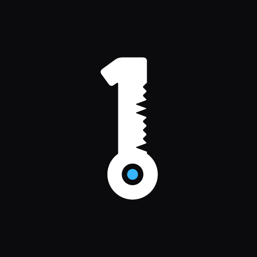
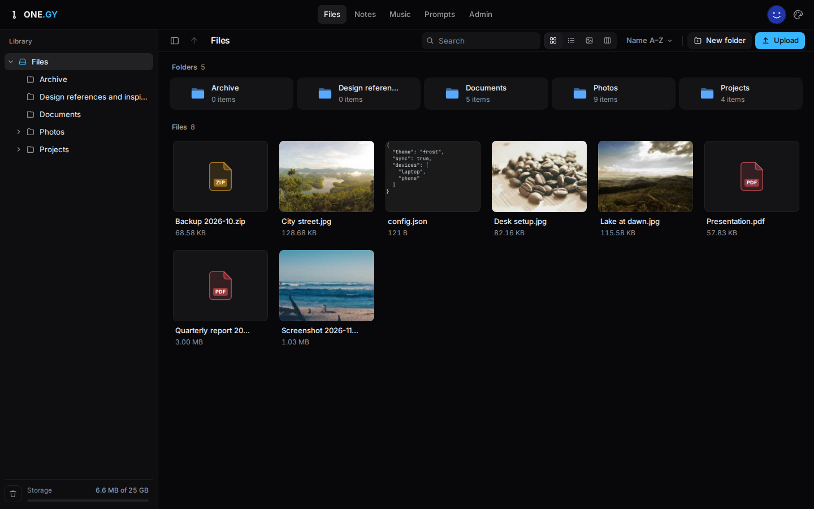
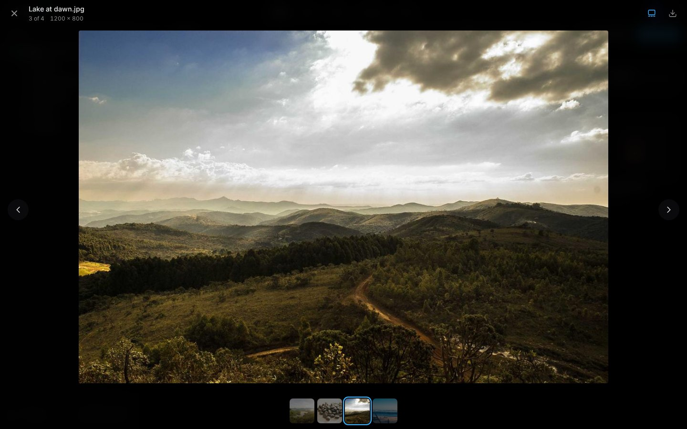
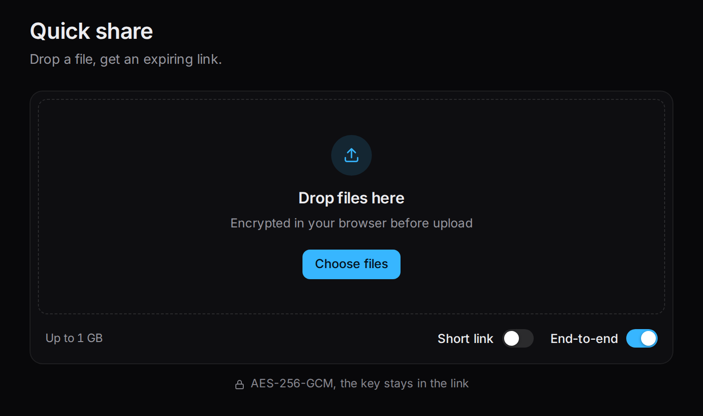
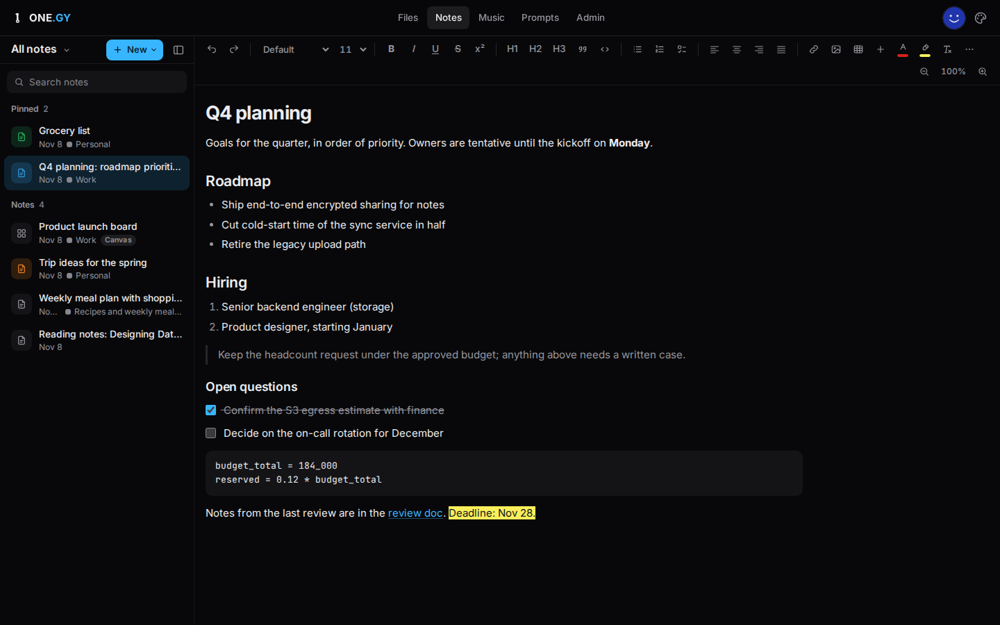
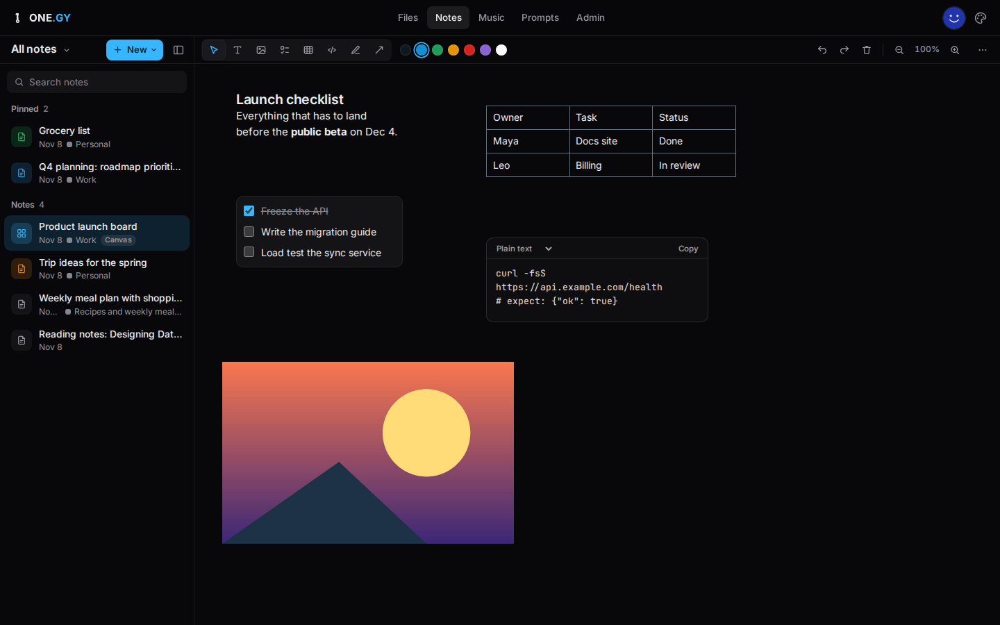
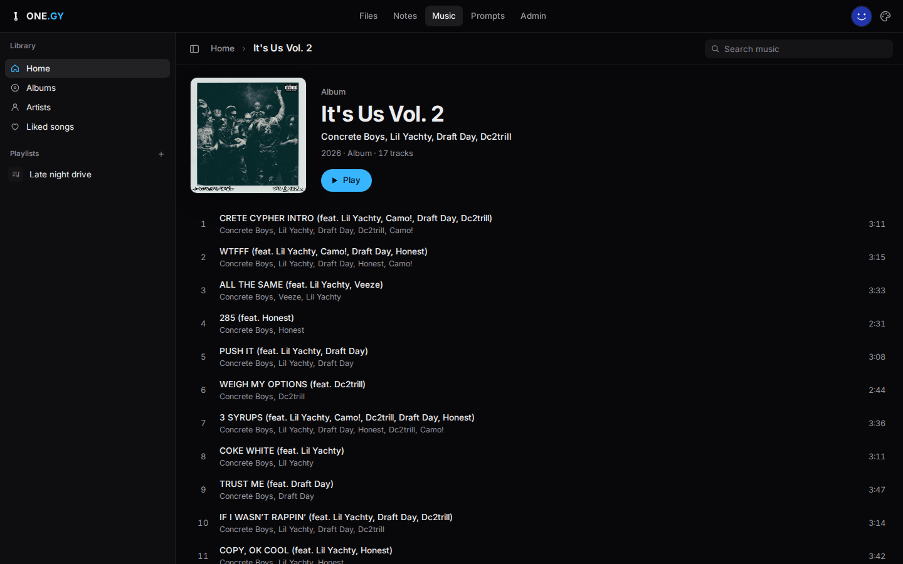
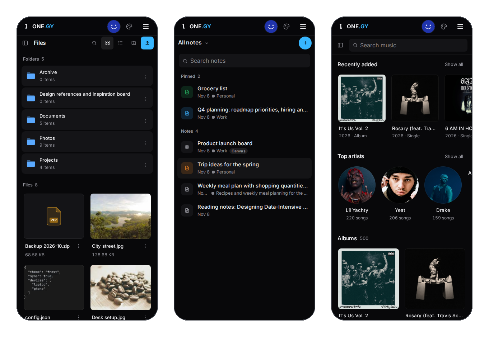
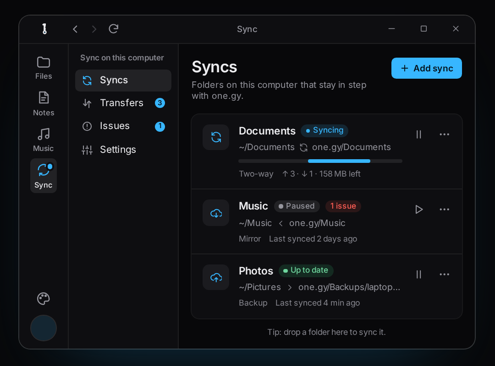
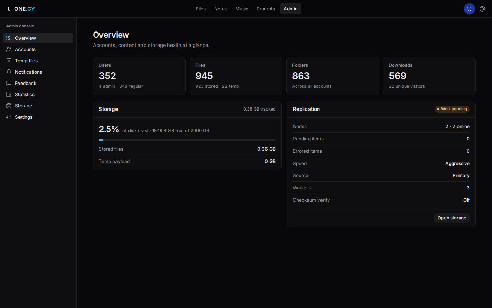

<div align="center">



# ONE.GY

### Your files, notes and music, encrypted before they leave your device.

A self-hosted, end-to-end encrypted cloud drive with share links, notes,<br>
a music player, desktop sync and a CLI. Your server only ever stores ciphertext.

[](https://github.com/tifuck/one.gy/releases/latest)
[](LICENSE)


[**Try it at one.gy**](https://one.gy) ·
[Features](#features) ·
[Desktop app](#desktop-app-and-cli) ·
[Self-host](#install) ·
[Configuration](#configuration)

<br>



</div>

<br>

**ONE.GY** is a private Google Drive you run yourself. Files, filenames and
notes are encrypted in your browser with AES-256-GCM before upload, and your
password never reaches the server. Share anything by link: the key travels
after the `#`, so the server can't read what it hosts, even when it's yours.

<table>
<tr>
<td width="33%" valign="top">

**🔐 End-to-end encrypted**<br>
Files, names and notes are sealed on your device. Each file and note has its
own key, wrapped by a master key only you can unlock.

</td>
<td width="33%" valign="top">

**🔗 Links that carry their key**<br>
Share files or whole folders. Add an expiry, a download limit or a password.
Quick share works without an account.

</td>
<td width="33%" valign="top">

**📝 Notes and canvases**<br>
Rich-text notes with checklists, tables and code, plus freeform canvas
boards. Pinned, colour-tagged and encrypted.

</td>
</tr>
<tr>
<td valign="top">

**🎵 Music**<br>
Stream your own library: albums, artists, playlists and liked songs, on
desktop and phone.

</td>
<td valign="top">

**💻 Desktop sync**<br>
Windows and Linux app with live folder sync: two-way, backup or mirror.
Encrypted on your machine.

</td>
<td valign="top">

**⌨️ CLI and API**<br>
`onegy` encrypts locally, uploads and decrypts share links. A REST API with
per-user keys covers the rest.

</td>
</tr>
<tr>
<td valign="top">

**🛟 Replication**<br>
Mirror every file to S3-compatible or SSH storage nodes, checksum-verified
and scrubbed for integrity.

</td>
<td valign="top">

**🕘 Versions and trash**<br>
Previous versions of a file are kept, and deletes go to a trash you can
restore from.

</td>
<td valign="top">

**🛡️ Locked-down sign-in**<br>
Split-key login, two-factor authentication, a recovery key you keep, and
sign-out of every session in one click.

</td>
</tr>
</table>

---

## Features

### A drive that can't read your files



- Upload, drag and drop, move, rename and search across everything. Grid,
  list, gallery and column views.
- Previews for images, PDFs, text and code open full screen, decrypted in the
  browser.
- The server stores ciphertext, a wrapped master key and a SHA-256 hash of
  your sign-in token. That's it:

| Data | Stored as | Readable by the server |
|---|---|:-:|
| File contents, filenames, notes | Ciphertext | No |
| Master key | Wrapped, never raw | No |
| Link keys | Not stored | No |
| Password | Not stored | No |
| Sign-in token | SHA-256 hash | Hash only |

Your password is stretched with PBKDF2 (600,000 iterations) in the browser and
split in two: one half signs you in, the other unlocks your keys.

### Share in seconds



- **Quick share**: drop a file, get an expiring link. No account needed.
- **Share links** for any file or folder in your drive, with optional expiry,
  download limit and password.
- The decryption key lives in the link fragment (`#…`), which browsers never
  send to a server.

### Notes and canvases

<p>
  
  
</p>

- A full editor: headings, lists, checklists, tables, quotes, code blocks,
  links, colours and highlights.
- **Canvas** boards for free-form layouts: text, checklists, tables, code,
  images, drawings and arrows.
- Pin, colour-tag and group notes into notebooks. Every note is encrypted with
  its own key.

### Your music, streamed



Point ONE.GY at a music folder on the server and it builds a library with
albums, artists, cover art, playlists and liked songs.

### Fits in your pocket



Every page is built for phones too, no app store needed.

### Desktop app and CLI



**ONE.GY Desktop** puts your drive in its own window and keeps folders on your
computer in sync, encrypted with the same keys as the website.

- **Two-way**, **backup** or **mirror**, as many folder pairs as you like.
- Works with one.gy or any self-hosted server.
- Windows, `.deb`, `.rpm` and AppImage builds that update themselves.

[**Download the desktop app**](https://github.com/tifuck/one.gy/releases/latest)

The **`onegy` CLI** for Linux and macOS is served by your own instance. It
encrypts before it uploads, decrypts any share link it downloads, and checks
every update against a SHA-256 manifest. See `/docs` on your server.

<br clear="right">

### Built for self-hosters



- An admin console for accounts, storage, notifications, feedback and
  statistics.
- Storage nodes on **S3-compatible** services (Backblaze B2, AWS, MinIO…) or
  over **SSH**, with background replication and integrity scrubs.
- Feature flags and limits change at runtime, no restart needed.
- Light and dark themes.

---

## Install

### Requirements

- Linux with systemd (optional), Python 3.12 with `venv`, OpenSSL
- MariaDB or MySQL
- Go 1.22+ (optional; builds the CLI that the site serves for download)

On Debian/Ubuntu: `sudo apt install python3 python3-venv mariadb-server openssl`, plus Go from https://go.dev/dl/.

### Setup

```bash
git clone https://github.com/tifuck/one.gy.git && cd one.gy
bash setup.sh
```

`setup.sh` walks you through everything and is safe to re-run (it keeps an existing `venv/`, `.env` and certificate):

1. installs the Python dependencies into `venv/`
2. creates a database and user (or takes your own `DATABASE_URL`)
3. writes `.env` with freshly generated `SECRET_KEY` and `FERNET_KEY`, your domain, port and bind address (behind a reverse proxy it binds to `127.0.0.1` by default and asks for `TRUSTED_PROXY_IPS`)
4. creates a self-signed certificate or links an existing one (gunicorn serves HTTPS from `cert.pem` / `key.pem`)
5. creates the database schema and builds the CLI
6. optionally installs and starts `onegy.service`

### First admin

Open `https://<your-domain>/register` and register immediately after setup. **The first account registered becomes the administrator.** For a private instance, turn registration off afterwards in the admin settings.

> [!CAUTION]
> Registration is open to anyone who can reach the server. Until you have registered, whoever gets there first claims admin, so register before you open the firewall or share the address.

> [!WARNING]
> Back up `.env`. Losing `FERNET_KEY` makes server-side encrypted data and storage-node credentials unrecoverable.

### Running and updating

- Run `bash start.sh` or use the systemd service. Either one upgrades the schema, runs startup maintenance, then starts gunicorn on `BIND_HOST:WEB_PORT`.
- Logs: `journalctl -u onegy -f`.
- To update: `git pull`, `venv/bin/pip install -r requirements.txt`, rebuild the CLI with `(cd cli_E2EE_binary && bash build.sh)`, then `sudo systemctl restart onegy`.

## Configuration

- `.env` holds secrets and per-deployment settings. Every variable is documented in `.env.example`.
- Feature flags and tunables can be changed at runtime in the admin UI. These DB settings override the `.env` defaults.
- Behind a reverse proxy, set `TRUSTED_PROXY_HOPS` to the number of proxies and `TRUSTED_PROXY_IPS` to their addresses or CIDRs (comma-separated). `X-Forwarded-*` headers are then honoured only from those peers. Bind to `127.0.0.1` when the proxy runs on the same machine; otherwise firewall `WEB_PORT` so clients cannot bypass the proxy and forge `X-Forwarded-For`.
- Music library: set `MUSIC_LIBRARY_PATH` (default `<home>/music`). Keep it outside the app folder.
- User data lives in `uploads/`, `thumbnails/` and `notes/` in the app folder. Storage nodes are added in the admin UI.

<details>
<summary><b>How it's built</b></summary>

- **Server**: Flask + MariaDB behind gunicorn, with a scheduler for replication, integrity scrubs and cleanup.
- **Web app**: plain JavaScript and Web Crypto, no framework or build step.
- **CLI and sync engine**: Go, sharing one E2EE package (`cli_E2EE_binary/e2ee`) that is byte-compatible with the browser crypto.
- **Desktop app**: Electron shell around the site plus the Go sync engine (`desktop/`).

</details>

## License

MIT. See [LICENSE](LICENSE).
